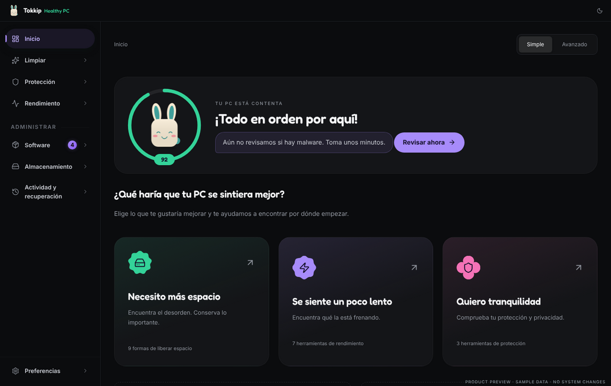
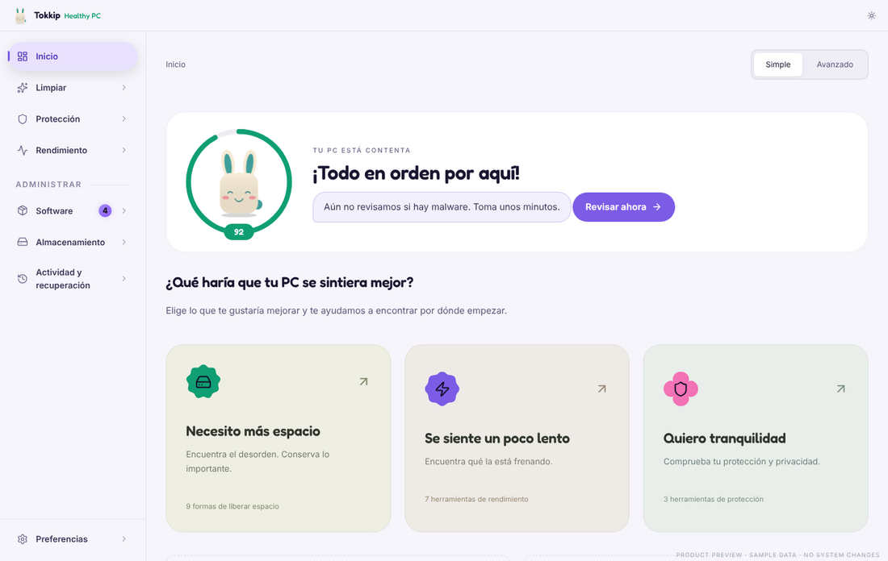

<p align="center">
  
</p>

<h1 align="center">Tokkip Healthy PC</h1>

<p align="center">
  Limpia, cuida y optimiza tu PC con Tokkip. Gratis, de código abierto y sin nube.
</p>

<p align="center">
  
</p>

## Qué es

Tokkip Healthy PC es el limpiador y optimizador de la familia Tokkip (Tokkip en
el teléfono y el reloj, Tokkip Notas y Tokkip PC). Está hecho a partir de
[Kudu](https://github.com/adventdevinc/kudu) (MIT), con el diseño de Tokkip y
sin nada de Kudu Cloud: todo pasa en tu computadora.

- **Tokkip te dice cómo se siente tu PC**: en Inicio está dentro de un anillo
  que se llena con la salud de tu PC (cuándo limpiaste, qué tan llenos van
  tus discos, la última revisión de malware). Su cara cambia: contento, bien,
  cansado o mareado. Te dice el porqué y te lleva al siguiente paso.
- **Fiesta al limpiar**: cuando liberas espacio, Tokkip baila con ojos de
  estrella sobre una galleta de Material Expressive, con confeti, y te dice
  cuánto liberaste.

  

- **Todas las herramientas de Kudu**: limpiador del sistema, navegadores, apps
  y juegos; registro; programas de inicio; red; rutinas automáticas;
  escáner de malware (Windows Defender, heurística y tus reglas YARA locales);
  privacidad; firewall; monitor de rendimiento; servicios; modo juego;
  actualizaciones de software y controladores; desinstalador; quitar
  bloatware; menú contextual; análisis de disco, espacio por app, historial de
  almacenamiento, descargas, duplicados, archivos grandes, carpetas vacías,
  destructor de archivos, reparación de Windows y mantenimiento de disco;
  actividad y centro de recuperación.
- **Con Tokkip PC**: si tienes la isla de Tokkip en Windows, su tarjeta del día
  muestra cómo se siente tu PC y te avisa cuando limpiaste o cuando necesita
  un respiro. Se comunican con un archivito local
  (`%APPDATA%\Tokkip\shared\healthy-pc.json`), nada sale de tu PC.
- En **Preferencias → Tokkip** escoges su especie (conejito, gatito, perrito,
  robotito o mapache), su color y si quieres sus sonidos.
- Español e inglés. Modo claro, oscuro o el de tu sistema.



## Qué cambió respecto a Kudu

- Sin Kudu Cloud: se quitaron la vinculación, el agente y el modo daemon, y las
  herramientas que solo funcionaban con la nube (monitor de amenazas, escáner
  de vulnerabilidades, alertas de filtraciones, diagnóstico de rendimiento y
  las calificaciones de seguridad de programas). Las firmas YARA ya no se
  descargan de Kudu: el escáner lee los archivos `.yar` que pongas en tu
  carpeta de firmas (se abre desde la pestaña Base de datos del escáner).
- Diseño de Tokkip: su paleta, títulos en Fredoka, esquinas redondeadas y
  formas de Material Expressive; Tokkip en la barra de título y en Inicio.
- Solo español (de tú) e inglés.
- Nuevo nombre, ícono, identificador (`mx.loperstack.tokkiphealthypc`) y
  actualizaciones desde los releases de este repositorio.

## Instalar

En la pestaña **Actions** → **Build - Windows** → la última ejecución, descarga
`TokkipHealthyPC-Windows` (instalador `TokkipHealthyPC-Setup-*.exe` o la versión
portable). No está firmado, así que Windows SmartScreen te preguntará la
primera vez: **Más información → Ejecutar de todas formas**. Pide permisos de
administrador porque limpia y repara partes del sistema.

Con una etiqueta `v*` el mismo workflow publica un release, y la app instalada
se actualiza sola desde ahí.

## Compilar

Node 22 (ver `.nvmrc`):

```bash
npm install
npm run dev            # la app en modo desarrollo
npm run build          # compila
npx electron-builder --win   # el instalador
npm run check          # tipos, lint, formato, reglas y pruebas
npm run dev:ui         # la interfaz en el navegador con datos de ejemplo
```

Las reglas de limpieza son JSON en `rules/` (guía en
[rules/RULES.md](rules/RULES.md)); la línea de comandos (`--cli`) está en [CLI.md](CLI.md).

## Créditos y licencia

[MIT](LICENSE). Basado en [Kudu](https://github.com/adventdevinc/kudu) de
Advent Development Inc y su comunidad (MIT) — gracias por todo el trabajo que
hay debajo. Tokkip y su diseño son de Andy (LoperStack). Fuente Fredoka bajo
SIL Open Font License ([licenses/OFL-Fredoka.txt](licenses/OFL-Fredoka.txt)).

Tokkip Healthy PC borra archivos por diseño: revisa lo que vas a limpiar. Se
ofrece "tal cual", sin garantía.
